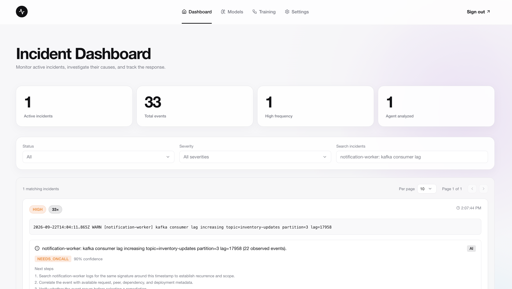
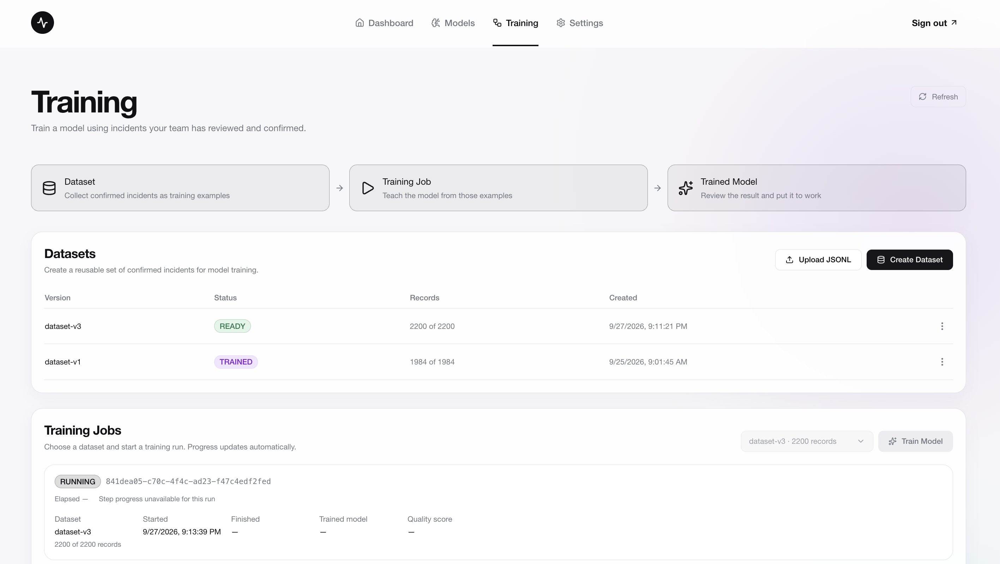
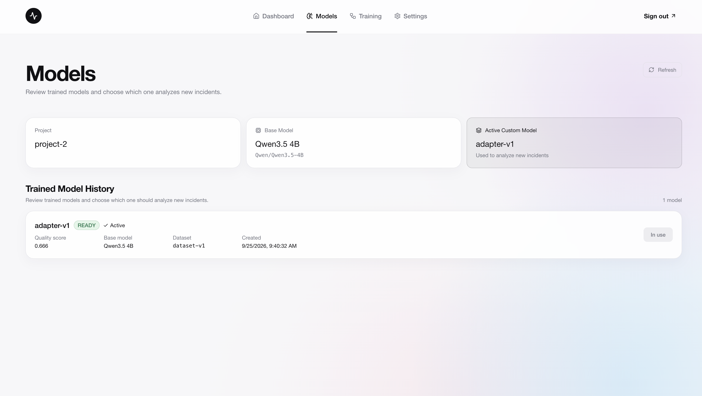
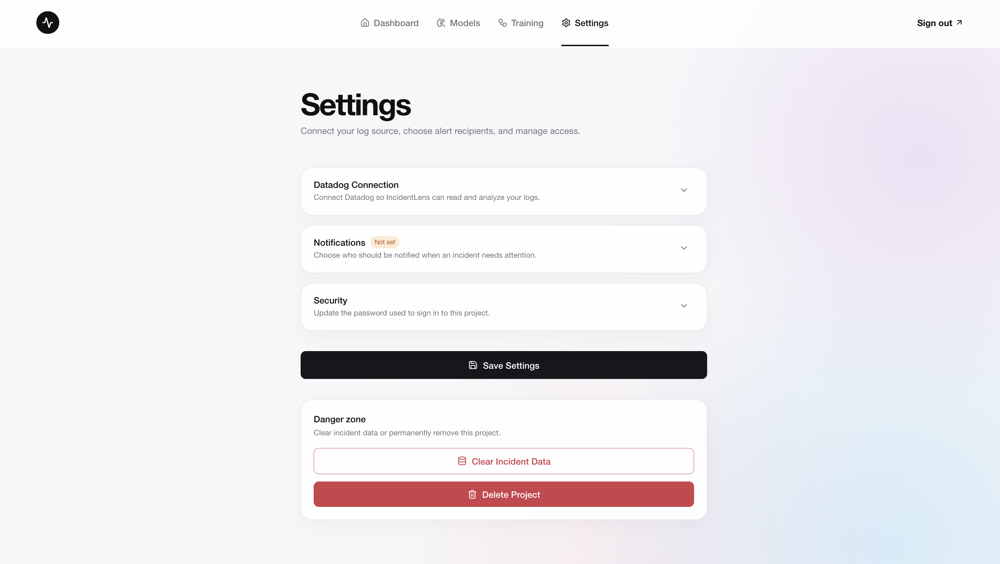
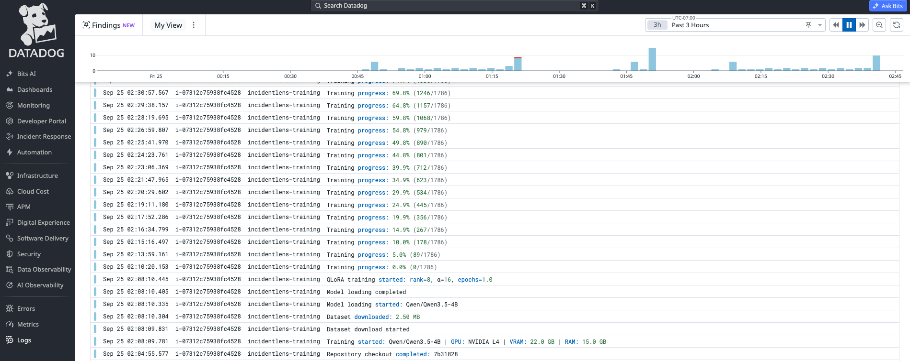

# IncidentLens

Incidents rarely appear as a single clear error. Engineers must connect noisy log events, understand impact, and decide what to investigate next. **IncidentLens explores how language models can turn those event sequences into a concise incident assessment grounded in the available evidence.**

[Portfolio and demo](https://sivasanker.vercel.app/projects/incident-lens)

<p align="center"></p>

## Benchmark results

200-scenario comparison of the base and fine-tuned Qwen3.5 4B models:

| Metric | Base | Fine-tuned |
| --- | ---: | ---: |
| Joint severity + response accuracy | 72.0% (144/200) | **83.0% (166/200)** |
| Severity accuracy | 78.5% (157/200) | **88.0% (176/200)** |
| Response accuracy | 81.0% (162/200) | **90.5% (181/200)** |
| Root-cause identification accuracy | 58.0% (116/200) | **72.5% (145/200)** |
| Fully grounded explanation rate | 64.0% (128/200) | **75.5% (151/200)** |

## Product capabilities

- **Incident grouping:** correlates repeated warnings and errors into an incident instead of analyzing every log line independently.
- **Triage:** estimates severity and recommends a separate operational disposition.
- **Investigation:** summarizes the evidence, offers a suspected cause, and suggests follow-up checks.
- **Workflow:** presents assessments, incidents, datasets, training jobs, and model versions in a web console.

<p align="center">
  
  
</p>

## Architecture

```text
                 +------------------+
                 |  React Console   |
                 +--------+---------+
                          | REST API
                          v
                 +--------+---------+       +----------------+
 Datadog Logs -->| FastAPI Backend  |------>| Neon Postgres  |
                 | Control / Data   |       | Incidents/jobs |
                 | Serving / Train  |       +----------------+
                 +----+---------+---+
                      |         |
       Incident flow  |         | Training request
                      v         v
            +---------+--+   +--+----------------+
            | Evidence + |   | On-demand GPU EC2 |
            | Triage     |   | QLoRA fine-tuning |
            +-----+------+   +--+----------------+
                  |             |             |
                  v             v             v
          Qwen3.5 4B + LoRA   Amazon S3    Datadog
          Structured result  Data/adapters  Telemetry
```

The backend is a modular monolith organized into **Control, Data, Serving, and Training** planes. The React console uses the FastAPI API; PostgreSQL stores relational application state, while S3 stores larger datasets and model artifacts. The deployed API runs in Docker on EC2; GPU fine-tuning runs on separate temporary instances.

## Incident analysis flow

1. **Ingest:** a provider-neutral connector interface normalizes log sources into a common envelope. The Datadog connector searches the v2 Logs API with project-specific credentials, follows pagination cursors, and preserves provider event IDs.
2. **Group:** the parser extracts timestamps, levels, services, and attributes. Actionable `WARN`, `ERROR`, and `CRITICAL` events are clustered by source and signature; repeated events update the same incident.
3. **Build evidence:** IncidentLens collects up to eight sample lines and up to five related open incidents from the same project in a 15-minute window.
4. **Assess:** deterministic triage is persisted first. The local model can enrich the result with a structured JSON analysis, but its candidate cannot lower the severity or disposition established by the evidence baseline.
5. **Apply policy:** confidence and incident state are checked before side effects. Allowed actions are limited to enrichment, suppression under strict conditions, and configured notifications. Destructive operations such as restarts, rollbacks, deployments, and data deletion are blocked.
6. **Recover:** incident analysis is stored before model inference. Failed or interrupted processing leaves provider events retryable, and a recovery worker reprocesses incidents that have no saved analysis.

The analysis contract includes severity, disposition, confidence, summary, suspected root cause, next steps, and ticket fields. Severity describes observed impact; disposition describes the operational response.

```json
{
  "severity": "high",
  "disposition": "NEEDS_ONCALL",
  "confidence": 0.87,
  "summary": "Repeated database connection failures affected checkout requests.",
  "suspected_root_cause": "The logs show pool exhaustion; they do not establish why it occurred.",
  "next_steps": ["Check connection usage and request volume."],
  "ticket_title": "Investigate checkout connection failures",
  "ticket_body": "Review pool metrics and correlated application logs."
}
```

## Tech stack

| Area | Technology |
| --- | --- |
| Frontend | React |
| API and backend | FastAPI, Python |
| Language model | Qwen/Qwen3.5-4B |
| Fine-tuning | LoRA / QLoRA, PyTorch, Transformers, PEFT |
| Application database | Neon PostgreSQL |
| Dataset and adapter storage | Amazon S3 |
| Training compute | On-demand Amazon EC2 GPU |
| Observability | Datadog APM, Logs, LLM Observability |
| Containers and deployment | Docker, Docker Compose, GitHub Actions |

## Dataset and fine-tuning

The training contract is JSONL: related log sequences are paired with a structured assistant response containing severity, disposition, confidence, summary, suspected cause, next steps, and ticket fields. The checked-in [`data/dataset_v4.jsonl`](data/dataset_v4.jsonl) contains 2,200 records, with multi-event examples spanning database, Kafka, Redis, networking, deployment, memory, Kubernetes, authentication, and queue failures.

The application dataset builder selects completed model analyses with usable log context and excludes rule-only fallback analyses. Each record carries a `scenario_group_id` based on its incident signature. The trainer holds whole groups together in its validation split; when a group ID is absent, it uses a hash of the log sequence. Training loss is applied to assistant completion tokens, not the input prompt.

| Training setting | Value |
| --- | ---: |
| Base model | `Qwen/Qwen3.5-4B` |
| LoRA rank / alpha | 16 / 32 |
| Dropout / target modules | 0.05 / all-linear |
| Learning rate / epochs | 1e-4 / 3 |
| Batch size / gradient accumulation | 2 / 8 |
| Maximum sequence length | 1,536 tokens |
| Validation split / seed | 10% / 42 |

The configured dataset audit checks chronology, severity and disposition coverage, recovered high-urgency examples, target grounding, and duplicate targets/summaries. See [`local-experiment/config.yaml`](local-experiment/config.yaml), [`dataset_builder.py`](log-analyzer/app/training/dataset_builder.py), and [`lora_trainer.py`](log-analyzer/app/training/lora_trainer.py).

## Model serving and artifact lifecycle

- A shared Qwen3.5 4B base model serves projects; each project can select its own active LoRA adapter.
- The runtime verifies that an adapter belongs to the project and matches the configured base model before loading it. S3 artifacts are restored into a local cache when needed.
- The training job evaluator checks dataset record counts, completion and loss fields, adapter configuration, weights, and artifact manifest hashes before accepting the result.
- If a project has no usable adapter or inference fails, the saved deterministic triage remains available as the analysis result.

Training job and artifact metadata live in the application database; the larger adapter files live in S3. This keeps model versions independently addressable and avoids storing duplicate full base-model weights for every project.

## Evaluation

The headline benchmark compares the base Qwen3.5 4B model with its fine-tuned adapter on the same 200 unseen scenarios, prompt template, and inference settings. Metrics are:

- **Joint classification:** severity and disposition must both match.
- **Severity and response:** reported as independent accuracy measures.
- **Root cause:** judged against acceptable evidence-supported causes, including cases where logs do not support a specific cause.
- **Grounded explanation:** factual statements must be supported by the input logs; suggested investigation steps are treated as recommendations.

Invalid JSON or invalid classifications count as incorrect. The repository also has a separate action-policy suite at [`log-analyzer/evals/action_policy_cases.json`](log-analyzer/evals/action_policy_cases.json); it is not part of the five headline metrics.

## On-demand GPU training

Training is an ephemeral workload, separate from the API's CPU inference service:

1. A queued job uploads its configuration to S3 and launches a tagged EC2 GPU instance (`g6.xlarge` by default).
2. The bootstrap checks out the requested Git commit, downloads the dataset, and runs QLoRA.
3. The adapter and metadata are uploaded to S3; job state is updated in the application database.
4. The instance requests termination from a `finally` cleanup path on success or failure. `SIGINT` and `SIGTERM` are converted into cleanup-triggering exceptions.

Training progress, loss, validation, artifact upload, and lifecycle status can be sent to Datadog. Provisioning GPU capacity per job avoids keeping an idle training instance running between jobs. See the [EC2 orchestrator](log-analyzer/app/training/ec2_orchestrator.py), [training bootstrap](log-analyzer/scripts/bootstrap-training.py), and [training logger](log-analyzer/app/training/datadog_logger.py).

## Observability and reliability

- **Datadog log polling:** project-level query and service filters are combined with `env:prod`; a polling cursor advances only after successful processing.
- **Idempotent ingestion:** provider IDs are recorded after incident and analysis persistence, so failures remain retryable.
- **Recovery:** the worker retries incomplete analysis after interruptions instead of dropping an incident when model inference fails.
- **APM and LLM traces:** lifecycle spans cover ingestion, analysis, policy, training, evaluation, and artifact operations. Metadata uses an allowlist; credentials, prompts, and raw model output are not included.
- **Operational logs:** pipeline, recovery, and analysis stages include structured context and tracebacks for failures.

Configuration and ingestion details are in [`log-analyzer/README.md`](log-analyzer/README.md). The supplementary Datadog screenshots are below.

## Deployment and local development

The GitHub Actions workflow runs backend tests, builds a release bundle, and deploys the API to EC2. The React frontend is deployed separately. Locally, PostgreSQL is provided by Docker Compose.

```bash
cp .env.example .env
docker compose up -d postgres

cd log-analyzer
python3.11 -m venv .venv
source .venv/bin/activate
pip install -r requirements.txt
ddtrace-run uvicorn app.main:app --reload
```

In another terminal, start the frontend:

```bash
cd log-analyzer-frontend
npm ci
npm start
```

See [`log-analyzer/README.md`](log-analyzer/README.md) for Datadog setup and backend configuration. Training settings and the local experiment workflow are in [`local-experiment/config.yaml`](local-experiment/config.yaml) and [`local-experiment/train.py`](local-experiment/train.py).

## Limitations

- A suspected root cause remains a hypothesis unless the logs directly establish it; explanation grounding is harder than classification.
- Graceful cleanup handles normal completion, failures, and catchable termination signals; forced host loss cannot run the instance cleanup handler.

## More screenshots

<p align="center">
  
  
</p>
